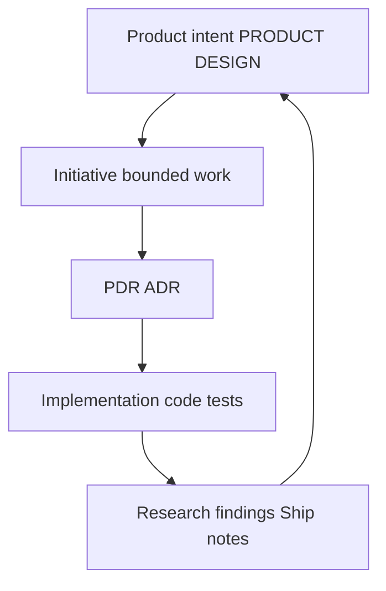

# Project context

Flow spreads product intent, decisions, and implementation across **ordinary repository documents**. If this page and [flow.md](../flow.md) ever disagree, **flow.md wins**.

## Where to put what

| You need | Open |
| --- | --- |
| Product vision, audience, scope | [PRODUCT.md](../../../PRODUCT.md) |
| Experience and interaction direction | [DESIGN.md](../../../DESIGN.md) |
| Current technical structure | [ARCHITECTURE.md](../../../ARCHITECTURE.md) |
| Consequential product rationale | `docs/pdr/` when the first record exists |
| Consequential product architecture | [docs/adr/](../../../docs/adr/) |
| Factory stack and agent architecture rationale | [decisions/adr/](../decisions/adr/) |
| Factory engineering principles | [decisions/pdr/](../decisions/pdr/) |
| Bounded product work with tasks and findings | `docs/initiatives/` when used |
| Product research and assessments | `docs/research/` (dated filenames) when used |
| Product capability contracts | `docs/specs/` when justified |
| Flow Factory adoption and inherited stack | [factory.md](../factory.md), [architecture.md](../architecture.md) |
| Terms specific to this factory checkout | [GLOSSARY.md](../glossary.md) |
| Agent procedures (skills, worktrees, verify) | [.agents/flow/operations/](../operations/) |
| Worthwhile ideas not yet committed | `docs/ideas/<slug>.md` when first needed ([flow.md](../flow.md)) |

**Ideas** are possibilities. **Initiatives** are intentional bounded work. Moving from idea to initiative is a deliberate choice, not an automatic pipeline.

Naming rules, metadata for research and specs, and the full ownership table: [flow.md](../flow.md#documentation-ownership).

## Context for coding agents

Agents begin with the current product contracts and load deeper references as the task requires. PRODUCT.md, DESIGN.md, and ARCHITECTURE.md provide the current shared context. Initiatives own bounded execution detail, while ADRs and PDRs preserve consequential decisions and rationale.

Documents should be updated at their authoritative location. Do not duplicate the same requirements across several files simply to make them easier for agents to discover.

## Traceability

Feedback from evidence may send you back to Explore or to update an accepted contract—without silently rewriting intent to match accidental code.

## Example: team comments

- **Initiative** `docs/initiatives/team-comments.md` (when created): assumption, scope, tasks, validation, findings.
- **PRODUCT.md** changes only if the product-wide audience or promise changes.
- **ADR** only if you make a hard-to-reverse technical choice worth surprising future readers.
- **Research** if you preserve external evidence with dated metadata.

Agents route through [AGENTS.md](../../../AGENTS.md); they should read the documents the task touches, not the entire tree.
