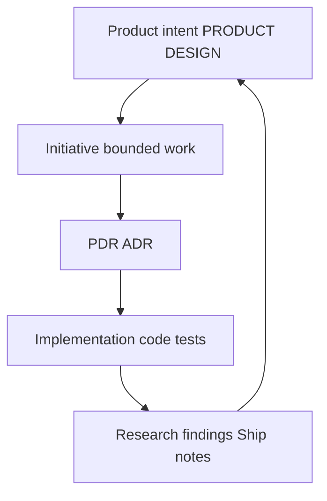

# Project context

Flow spreads product intent, decisions, and implementation across **ordinary repository documents**. If this page and [flow.md](../flow.md) ever disagree, **flow.md wins**.

## Where to put what

| You need | Open |
| --- | --- |
| Product vision, audience, scope | Adopter-owned [PRODUCT.md](../../../PRODUCT.md) |
| Experience and interaction direction | [DESIGN.md](../../../DESIGN.md) |
| Current technical structure | [ARCHITECTURE.md](../../../ARCHITECTURE.md) |
| Consequential product rationale | [docs/pdr/](../../../docs/pdr/) |
| Consequential technical rationale | [docs/adr/](../../../docs/adr/) |
| Bounded work with tasks and findings | [docs/initiatives/](../../../docs/initiatives/) |
| Durable research and assessments | [docs/research/](../../../docs/research/) (dated filenames) |
| Detailed capability contracts | [docs/specs/](../../../docs/specs/) when justified |
| Starter adoption and stack narrative | [docs/readme.md](../../../docs/readme.md) |
| Terms specific to this starter | [GLOSSARY.md](../../../GLOSSARY.md) |
| Agent procedures (skills, worktrees, verify) | [.agents/flow/operations/](../operations/) |
| Worthwhile ideas not yet committed | `docs/ideas/<slug>.md` when first needed ([flow.md](../flow.md)) |

**Ideas** are possibilities. **Initiatives** are intentional bounded work. Moving from idea to initiative is a deliberate choice, not an automatic pipeline.

Naming rules, metadata for research and specs, and the full ownership table: [flow.md](../flow.md#documentation-ownership).

## Traceability

Feedback from evidence may send you back to Explore or to update an accepted contract—without silently rewriting intent to match accidental code.

## Example: team comments

- **Initiative** `docs/initiatives/team-comments.md` (when created): assumption, scope, tasks, validation, findings.
- **PRODUCT.md** changes only if the product-wide audience or promise changes.
- **ADR** only if you make a hard-to-reverse technical choice worth surprising future readers.
- **Research** if you preserve external evidence with dated metadata.

Agents route through [AGENTS.md](../../../AGENTS.md); they should read the documents the task touches, not the entire tree.

## Human guide vs agent bundle

The Flow Agent bundles a **short** set of sources at build time (including this readme’s entry page and `flow.md`). The sibling pages you are reading now are for **human navigation**; they are not added to that bundle.
