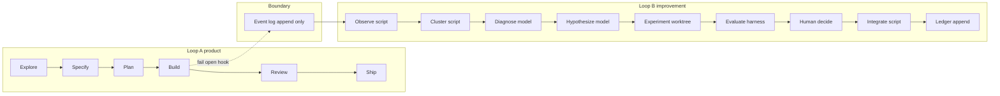

Date: 2026-10-24

# Initiative — Flow self-improvement (dogfooding v2)

**Status:** In progress

## Outcome

Improve Flow from evidence gathered while building Flow Starter, without blocking product work. Loop A (Explore → Specify → Plan → Build → Review → Ship) stays unchanged. A default-off observation path (Loop B) appends redacted metadata, clusters repeated workflow or skill failures, proposes minimal candidates in an isolated worktree, evaluates them with the existing `@repo/flow-eval` harness, and promotes only after human review at **L1**. Automatic merge (**L2**) is specified in [ADR 0013](../decisions/adr/0013-flow-improvement-autonomy.md) and is not built until that record is accepted.

**Recommended stop:** L1. L0 (observe + report) is the first implementation ship.

Loop B (L0 observer) is **not built**; Flow Factory alignment does not authorize implementing hooks or auto-observation in this batch.

## Related work

- Manual eval and remediation loop: [flow-improvement-loop.md](flow-improvement-loop.md)
- Harness and scenarios: [flow-evaluation-suite.md](flow-evaluation-suite.md)
- Operating summary: [improvement.md](../guides/improvement.md)
- Autonomy levels and L2 gate: [ADR 0013](../decisions/adr/0013-flow-improvement-autonomy.md) (**Proposed**)

## Assumptions

- The frozen baseline run `20261024-flow-v0.1-1256e532` has 0 complete transcripts and is not behavioral evidence for promotion until Phase 0 completes a live cycle with complete `stream-json`.
- Improvement-loop validity is tied to one explicit `model_id` per evaluation manifest, not the model label on historical checksums.
- Cursor hooks are fail-open; observation failures must never fail product tasks.
- `/Users/gabo/Code/flow/skills` was unavailable during planning; decisions live in this repo only.

## Invariants

Each invariant has a planned test or check (see Traceability).

1. Product agents never block on the improvement path.
2. An observation failure never fails the product workflow.
3. Every experiment has a bounded budget and deterministic cleanup.
4. A running task never silently switches Flow versions (session hashes + promote lock until S3 canary passes).
5. The candidate cannot modify the evaluator, rubric, holdout, thresholds, or promotion policy.
6. An improvement shows measurable value against a frozen baseline with repeated trials; missing telemetry is `missing`, not zero.
7. Improvement runs never spawn improvement runs.
8. Promotion is serialized and rollback-able.
9. Core Flow instructions respect a size budget (`flow-size-budget.json`).
10. Everything works with the path fully disabled (`flow-improve.config.json` `enabled: false` or `FLOW_IMPROVE=0`).

## Architecture



**Boundary.** Append-only JSON Lines at `<logDir>/events.jsonl` (default gitignored `__dev/flow-improve/`; override in `flow-improve.config.json`). Cap 4 MiB, three rotations. Loop A writes; Loop B reads. Hooks swallow errors and exit 0.

**Processing.** `stop` appends `task.completed`. `pnpm flow-improve report` clusters; no polling. No model inside the hook.

**Version isolation.** Stable Flow = product `HEAD` plus hashes of `AGENTS.md`, `.agents/flow/flow.md`, `.agents/flow/operations/*`, `skills-lock.json`, and `.agents/skills/flow-eval/SKILL.md`. Candidates only on `wt/flow-self-improvement/<id>` under `.worktrees/`. `promote` refuses while `<logDir>/active-sessions.json` lists a conversation newer than 6 hours until the S3 canary documents in-flight pinning.

**Clustering.** Signature `stage|failureType|skillsMarker`. Thresholds: **N = 3** occurrences, **M = 2** distinct `conversation_id`s (lower only via human ledger note). Classifier defaults to no candidate; experiment B is the gate.

**Writable by Improver (allowlist).** `AGENTS.md`, `.agents/flow/flow.md`, `.agents/flow/operations/*.md`, `.agents/flow/guides/improvement.md`. Protected paths include `packages/flow-eval/**`, hooks, `scripts/flow-improve/**`, size budget config, CI, security docs, ADRs, and holdout under `__dev/flow-evals/holdout/`.

## Autonomy levels

| Level | Behavior | Entry |
| --- | --- | --- |
| **L0 Observe** | Log events; `flow-improve report` | Phase 1 done |
| **L1 Propose** | Candidate branch + ledger; human `promote <id> --apply` | Phase 4 + live grader validation |
| **L2 Auto-low** | Auto-merge low-risk after gates | ADR 0013 **Accepted**, 3+ L1 accepts, zero canary failures, opt-in — **not in MVP** |
| **L3 Auto-medium** | Not in scope | — |

Risk: **low** = wording or deletion without gates or approval rules; **medium** = skill selection, delegation, orchestration; **high** = always human (security, evaluator, push rule, permission expansion).

## Audit summary (2026-10-24)

| Need | Path | Action |
| --- | --- | --- |
| Manual loop | [flow-improvement-loop.md](flow-improvement-loop.md) | Reuse |
| Harness | [packages/flow-eval](../../eval), [RUN.md](../../eval/RUN.md) | Extend (trials stats, worktree cleanup, holdout) |
| Worktrees | [scripts/worktrees.mjs](../../tooling/worktrees/worktrees.mjs) | Extend (`flow-self-improvement` slug) |
| Roles | `.cursor/agents/{builder,researcher,verifier}.md` | Reuse |
| Doc checks | `pnpm flow:check`, `pnpm flow-eval:check` | Reuse |
| Event log / ledger / hooks | — | New |
| S3 session pin | — | Spike in Phase 0 |
| D01–D17 | `classifyDelegation` unit tests only | Not behavioral evidence |

Core size ceilings (bytes/lines at planning): `AGENTS.md` 65 / 6694; `.agents/flow/operations/skills.md` 93 / 5916; `.agents/flow/flow.md` 408 / 24343.

## Schemas

JSON Lines, one object per line. Event kinds include `task.completed` with `conversationId`, `modelId`, `flowSha`, `flowHashes`, `stage` (default `unknown`), `skills` or `"missing"`, `subagents`, `toolFailures`, `commands` (`exitCode` null when unobserved), `files`, `followupCount`, redacted `excerpt`, `transcriptPath`. Ledger, candidate, experiment, and evaluation result shapes are defined in phase Build; retrieval via `pnpm flow-improve show <id>` and `signature <sig>` — never load the full ledger into agent context.

## Roles

| Role | Implementation | Writable |
| --- | --- | --- |
| Observer | Hook script | `<logDir>/events.jsonl` only |
| Diagnostician | Model on `report` when N,M met | None |
| Improver | Model in experiment worktree | Allowlist only; `FLOW_ROLE=improver` |
| Evaluator | Host `flow-eval` | `__dev/flow-evals/<runId>/`, log dir |
| Integrator | `promote.mjs` + lock | Local `main` on human `--apply`; no push |

## Phases

Each phase requires explicit **Build** authorization. Entry = previous phase acceptance.

| Phase | Deliverable | Acceptance (summary) |
| --- | --- | --- |
| **0** | Spikes S1–S5, one live eval | Complete `stream-json` on ≥1 scenario; bad variant fails gates; S3 canary logged; eval worktrees removed |
| **1** | L0 hook + config | `node --test scripts/flow-events.test.mjs`; disabled/failing writer exit 0 |
| **2** | Classify + cluster | Fixture replay stable; product correction ≠ candidate; Flow-doc correction = candidate (exp B) |
| **3** | Improver worktree | Protected path edit fails; cleanup after cancel |
| **4** | Compare + ledger | Adversarial fixtures fail; `pnpm flow-eval:check` 0 |
| **5** | L1 promote + rollback | Dirty tree, conflict, canary revert tested |
| **6** | Real cycle | One dogfood signature → promoted fix + canary |
| **7** | Portability | Second repo, config + hook only, observe-only |

**Phase 0 commands (when authorized):**

```bash
pnpm flow-eval:check
pnpm --filter @repo/flow-eval eval preserve
pnpm --filter @repo/flow-eval eval prepare --scenarios S13 --arm flow --repetition 3
```

Requires `agent login` or `CURSOR_API_KEY`. Dry-run is not acceptance evidence.

## Experiments (order)

A observe ordinary task · B classification fixtures · C Improver small change · D baseline vs candidate · E version after promote · F failure/conflict/rollback · G portability. **Stop** if A or B fails.

## Success and kill criteria

**Success (8 weeks after Phase 1 enabled):** ≥3 L1 promotions with ledger + repeated complete trials + passing canary; zero product failures from hooks; size budget held; ≤15 min review per candidate.

**Kill or pause:** grader accepts known-bad variant; no cluster reaches N,M in 10 tasks or 4 weeks; eval exceeds 12 sessions / 90 min / token cap; two reviews >30 min; Goodhart disagreement (benchmark `improved` but outcome rating not `helpful` twice).

## MVP

Phases 0–6 with compare set capped at 12 sessions (e.g. S13 + S01 × 3 reps × 2 arms). One real signature, one ledger row, human `--apply`, passing canary. Three-promotion bar is program success, not MVP.

## Progress

- [x] Initiative recorded (this document)
- [x] [ADR 0013](../decisions/adr/0013-flow-improvement-autonomy.md) recorded (**Proposed**)
- [x] Pointers in [learning-and-improvement.md](../guides/improvement.md) and [flow-improvement-loop.md](flow-improvement-loop.md)
- [ ] Phase 0 — Live eval validation and spikes
- [ ] Phase 1 — Observe (L0)
- [ ] Phase 2 — Cluster and diagnose
- [ ] Phase 3 — Experimental worktree
- [ ] Phase 4 — Compare and ledger
- [ ] Phase 5 — Promote (L1)
- [ ] Phase 6 — One real cycle
- [ ] Phase 7 — Portability

## Traceability

| Invariant | Component | Test |
| --- | --- | --- |
| 1–2 | `flow-events.mjs` fail-open | `flow-events.test.mjs` |
| 3 | Experiment budget + worktree cleanup | Phase 3/0 tests |
| 4 | Session hashes + `active-sessions.json` | Experiment E |
| 5 | Allowlist + host grader | Phase 4 adversarial fixtures |
| 6 | `inconclusive` on partial reps | compare extension |
| 7 | `FLOW_ROLE` + no hook followups | hook + improver contract |
| 8 | `promote.mjs` lock + revert | Phase 5 temp-repo tests |
| 9 | `check-flow-size.mjs` | candidate gate |
| 10 | `enabled: false`, `FLOW_IMPROVE=0` | `flow-events.test.mjs` |

## Findings

| Id | Summary | Status |
| --- | --- | --- |
| F-plan-001 | Historical baseline has no complete live transcripts; L1 stop line justified | Open until Phase 0 |
| F-plan-002 | Shell exit code not in documented `afterShellExecution` payload | Use `null` in events |
| F-plan-003 | S3 session pin unproven | Phase 0 canary |
| F-migrate-001 | Flow methodology consolidated under `.agents/flow/`; first-party skills under `.agents/skills/{flow,flow-eval,flow-improve}`; hooks/L2 deferred | Closed (2026-10-24) |
| F-dogfood-001 | No authentic Flow miss recorded for post-migration improve loop | Open until authorized Build + live task (auth may block eval) |

## Risks

Hook payload drift (Phase 0 dump); live auth blocked (Phase 0 gate); clusters below N,M (kill, do not lower N); prompt excerpts in gitignored log (redact per `packages/flow-eval/src/redact.ts`, 120 char cap, no `user_email`); eval worktree leak (cleanup in Phase 0).
