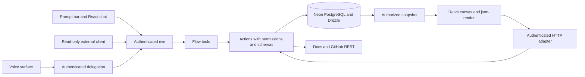

# Flow — Architecture

> Technical contract · Scope updated October 24, 2026. Voice research is dated October 17. The checkout remains a starter baseline; these integrations are specified, not implemented or validated together. Verify installed versions and deployment topology during implementation.

The initial release covers text, tables, architecture diagrams, grounded retrieval, and shared actions. Voice, external invocation, charts/metrics, dependency metadata, and video below are follow-on contracts, not initial release requirements. PRODUCT owns release scope.

## 1. Decisions and responsibilities

[PRODUCT.md](PRODUCT.md) governs scope; [DESIGN.md](DESIGN.md), presentation; [ROADMAP.md](ROADMAP.md), sequence and acceptance; [GLOSSARY.md](GLOSSARY.md), ubiquitous language; [docs/adr/](docs/adr/), recorded decisions; [docs/research/](docs/research/), dated primary-source evidence. These documents define methodology and boundaries; they are not a feature checklist and do not justify collapsing the Turborepo into a single-app repository.

| Area | Decision |
| --- | --- |
| Repository | Preserve Turborepo, the existing package manager, lockfile, and conventions. |
| Web | Next.js App Router, strict TypeScript, React; server by default and client where interaction requires it. |
| UI | Tailwind, shadcn/ui + Base UI, Geist Sans/Mono, light/dark. |
| Identity | Better Auth exclusively with GitHub OAuth; no passwords, other providers, organizations, or complex roles. |
| Agent | One eve agent for the `/dev` prompt and chat; authenticated external callers are follow-on work. |
| Models | Vercel AI SDK through eve for reasoning and tools; follow-on voice delegates domain work to eve. |
| Voice (follow-on) | Adapt the official eve Voice template approach; preserve GitHub identity and the existing `/dev` conversation. See §9. |
| Generative presentation | json-render with text, tables, and Mermaid initially; Recharts and verified video are follow-on components. |
| Knowledge | Fumadocs, Markdown, `llms.txt`, configured repository source and ownership records; bounded retrieval and revision-aware citations. |
| External data | Read-only GitHub REST for the configured repository; dependency metadata and curated videos are follow-on work. |
| Persistence | Neon PostgreSQL + Drizzle, provisioned and billed through the Vercel-managed integration. Justified by sessions/auth, ownership, persistent canvases, and versioned transactions. Start development on the Free plan. |
| Hosting | Vercel, with isolated previews, automated checks, controlled production releases, and recovery procedures. |
| Shared actions | UI controls and the agent call the same authorized server operations. Domain operations stay independent of the example route and of any transport. |

The runtime is **eve**; “if agent” in conversation refers to eve. Generative UI uses json-render. Vercel is the primary platform; add infrastructure only when a defined capability requires it.

## 2. Minimal structure within the monorepo

This map proposes responsibilities. Adapt names to the repository without recreating it or moving working applications.

```text
apps/web/
  app/                     # /, /dev, /docs, /api/auth; no per-chat page routes
  agent/
    instructions.md
    agent.ts
    channels/eve.ts        # browser verification; external callers later
    tools/                 # thin adapters to Flow capabilities
  src/canvas/              # catalog, renderer, and state client
  src/server/actions/      # schemas, permissions, and concrete operations
  src/server/auth/         # Better Auth and identity resolution
  src/server/db/           # Drizzle on Neon, repositories, and migrations
  src/docs/                # retrieval and sources
  content/docs/            # Fumadocs, unless apps/docs already exists
packages/                  # reuse existing UI/config packages
```

If `apps/docs` already exists, preserve it. Do not create a `core` package, SDK, CLI, MCP server, or generic event bus. Extract shared code only when eve's separate build or an actual consumer requires it. Server modules must never be imported by the renderer; serializable schemas and types may be shared.

The workspace remains at `/dev`. Chat and canvas IDs are internal identifiers, not generated page URLs. Restore the authenticated user's selected conversation through application state and server-owned records. Keep the workspace independent of the adopter's routes at `/` and document one deployment-level enable/disable setting. Disabling the workspace must reject its agent and tool endpoints as well as hide its page; it must not disable shared auth needed by the adopter's application.

Keep reusable domain operations independent of `/dev`, repository-explorer types, and transport adapters. Example-specific retrieval and views compose those operations. Document the first custom operation against implemented files rather than creating a public framework.

## 3. eve integration: verified and pending

The October 16 documentation review identified `withEve` from `eve/next` and `useEveAgent` from `eve/react`. The hook exposes messages, sending, status, cancellation, and resumption. The Next.js integration mounts eve routes and generates an agent service on Vercel: **one deployment project does not mean one process**. Initially placing `agent/` inside the web application reduces configuration. [Next.js](https://eve.dev/docs/guides/frontend/nextjs), [React client](https://eve.dev/docs/guides/frontend/overview).

The reviewed getting-started guide requires Node.js 24 or newer and uses `eve`, `ai`, and `zod`. Resolve compatible versions and pin them in the lockfile; do not copy versions from old examples or indiscriminately upgrade the entire monorepo. [eve getting started](https://eve.dev/docs/getting-started).

For tools, the published API is `defineTool` from `eve/tools`, with `inputSchema` and `execute(input, ctx)`. The adapter calls a Flow action rather than reimplementing its logic. Tools execute with server privileges: do not enable shell access, file writes, self-modification, or broad default tools for this product. Verify the effective tool inventory, including during the “text-only” phase. [Tools](https://eve.dev/docs/tools).

**Pending validation:** identity propagation into execution context, stream versions, imports of shared server-only modules, cancellation, replay, and builds in the existing topology. Do not assume eve's stream is interchangeable with AI SDK's `useChat`.

### External invocation (follow-on)

When external invocation is implemented, the same eve agent must accept requests from coding environments and other agents. eve documents a default HTTP channel for browser and non-browser clients, with per-deployment authentication. Use that channel rather than inventing another conversation runtime. Its infrastructure authenticators do not automatically authorize external production clients. [eve channel source documentation](https://github.com/vercel/eve/blob/main/docs/channels/eve.mdx).

Flow's integration contract is an authenticated question plus optional bounded context, returning answer text, source references, and an optional validated json-render spec. These are Flow requirements, not a claim about an existing eve response envelope. A structured result is returned through the pinned runtime's supported mechanism; verify the mechanism in the integration spike. Share retrieval, instructions, catalog validation, and observability with the browser path.

Default external capability: read-only answers and generated specs in a caller-owned session, without writing browser canvases. The server chooses the permitted tools for that caller; a prompt cannot grant mutation access. Do not infer selection from an open browser. A future change to this boundary requires explicit authorization and a defined target resource.

Deliver concrete setup and a reproducible invocation from both Codex and Cursor using their available HTTP/tool or command facilities. Do not assume either client exposes the agent automatically. A thin client configuration or invocation example is sufficient; a custom CLI, separate MCP server, and general agent federation are not requirements. Choose exact routes, event parsing, and authentication implementation against the installed eve version, then test success, failure, cancellation, and session isolation.

### Execution presentation

Show activity from authenticated eve state and completed tool results. Chat is where that activity is read. The canvas shows a concrete label only while an artifact is being created or updated. Keep request lifecycle, tool activity, canvas updates, connectivity, and later audio status distinct. Reuse existing shadcn Base UI chat primitives; they do not own transport. Filter sensitive data server-side before streaming UI activity. Verify event mapping against the pinned runtime instead of coercing eve messages into AI SDK message types. Visible treatment lives in [DESIGN.md](DESIGN.md).

## 4. Identity and authorization

Mount Better Auth in its App Router route. Configure only `socialProviders.github`; validate callbacks for local, preview, and production environments, secrets, and trusted origins. GitHub requires OAuth credentials and the provider's documented configuration. Signing in does not automatically authorize repository mutations or sharing data with the model. [GitHub OAuth](https://better-auth.com/docs/authentication/github), [Next.js](https://better-auth.com/docs/integrations/next).

eve supports a custom `AuthFn` in `eveChannel({ auth: ... })`. The adapter must validate the Better Auth session and return trusted user identity. This is a proposed integration built on documented APIs, not a tested Better Auth–eve plugin. Do not use anonymous authentication as a production fallback. [eve authentication](https://eve.dev/docs/guides/auth-and-route-protection).

Check ownership on **every** read, write, and subscription: chat, eve stream, resumption, canvas, data, and actions. Protecting `/dev` alone is insufficient. `ownerId`, roles, and permissions come from the server, never from model arguments. For durable operations, recheck current access before effects, even if the session existed when the turn began. Logout clears private client caches.

Browser users continue to authenticate exclusively with GitHub through Better Auth. External callers require a separate machine credential verified by the eve channel and mapped server-side to an existing owner and allowed capabilities. Do not copy browser cookies or accept model-supplied owner IDs. Keep credential provisioning operator-managed, with explicit expiry, revocation/rotation, and protected storage; a token-management UI is unnecessary. Validate the concrete verifier in the integration spike before exposing external access. Invalid, expired, or revoked credentials fail closed. Limit sessions, retrieval, and consumption per principal.

## 5. Persistence and flow

Use the [Better Auth Drizzle adapter](https://better-auth.com/docs/adapters/drizzle) and its required schema. Keep authentication tables, eve's internal runtime storage, and Flow data separate; sharing one Neon database does not mean sharing session formats.

Use **Neon** as the managed PostgreSQL provider. Keep Drizzle for schema, migrations, and queries. Database access stays in server modules. Neon supplies PostgreSQL; Better Auth remains the identity system.

- Provision through the **Vercel-managed Neon integration** so billing is handled through Vercel. Connecting an independently billed Neon account is a different integration path.
- Start development on the **Free plan**. Review current limits and upgrade when workload or production requirements justify it. Check the plan offered in Vercel at provisioning time; do not hard-code pricing or quotas into this contract. Neon usage is separate from Vercel hosting charges.
- Use isolated development and preview databases or branches. Keep production credentials out of those environments and define preview-branch cleanup when enabling automatic branching.
- Before production, validate the Drizzle driver against `@neondatabase/serverless`, connection pooling, the transaction behavior the Better Auth adapter requires, database region relative to the Vercel runtime, restore requirements, and latency after idle compute resumes. Choose production scale-to-zero settings from measured latency requirements.

The starter does not yet provision or connect to Neon. Provider references: [Vercel-managed integration](https://neon.com/docs/guides/vercel-managed-integration) and [pricing](https://neon.com/pricing).

Initial logical model:

| Entity | Essential data |
| --- | --- |
| `chats` | Opaque internal ID, owner, eve session reference, timestamps. |
| `canvases` | ID, chat/owner, `schemaVersion`, `version`, UI spec, and durable state JSON. |
| `canvas_datasets` | ID, canvas, bounded payload, source, parameters, `fetchedAt`, coverage. |

Do not duplicate eve's transcript in another table without a demonstrated need. Keep selection and navigation as session/tab context; do not persist tooltips, scroll position, or every pointer movement. Early canvases can use local fixtures; introduce their tables when persistence becomes a functional requirement.



UI and tools use the same actions. Server results update or invalidate the canvas query. Refetch when a mutating tool finishes, and when focus or connectivity returns. Use bounded polling only while awaiting a remote operation and as a recovery fallback. Do not add custom SSE, WebSockets, or CRDTs for canvas synchronization; eve chat streaming and provider voice transport are separate channels. Mutating operations carry a version and an idempotency key so retries do not duplicate effects and conflicts stay explicit.

## 6. Grounding and connectors

Fumadocs publishes the `llms.txt` index and per-page Markdown from the same editorial source. Its current API documents `llms()` and `index/page/full`; `page/full` require a content renderer. Do not install its “Ask AI” chat as a second agent. [LLM integration](https://www.fumadocs.dev/docs/integrations/llms).

First select excerpts deterministically by topic; later expose search and reading as tools. Read the index, select pages, and retrieve only relevant sections with URLs and versions/revisions when available. `llms.txt` does not perform retrieval automatically. Do not send all of `llms-full.txt` on every turn or add a vector database before measuring a need. Initial configurable budget: up to five excerpts and approximately 12,000 characters per retrieval.

### Repository evidence and follow-on ownership exploration

Configure one primary public repository (Flow itself or the adopter's fork). Add a curated technology → dependency repository catalog only when implementing dependency exploration. GitHub access is read-only and independent of GitHub sign-in; authentication to Flow does not grant repository access. Keep credentials server-side and limited to the registered public repositories and required reads.

Retrieve bounded text files and directory metadata for architecture questions: source modules, root documentation, dependency manifests, tests, workflows, and explicit ownership records. Resolve the selected branch to a commit before a retrieval batch; cite repository, commit, path, and line range when available. Key caches by repository and revision. Record retrieval time and disclose cached or incomplete evidence. Exclude credentials, environment files, generated output, vendor trees, and binary content; bound file size, excerpts, request count, and total context. Retrieval is not arbitrary shell or filesystem access.

A deployed instance identifies its deployed revision when answering questions about its running behavior. A repository-head answer names the inspected revision and does not imply deployment. When documents and source disagree, describe both and use source to establish observed implementation. Missing files or insufficient evidence produce a bounded answer rather than a guess.

Use explicit maintainer declarations and CODEOWNERS for their stated roles; code review ownership is not automatically project-wide maintainership. Keep contributor metrics separate. GitHub reads require bounded pagination, caching, limited concurrency, backoff, and rate-limit handling. Show coverage and `fetchedAt`; a partial contributor list is not a complete census. [REST repositories](https://docs.github.com/en/rest/repos/repos#list-repository-contributors).

For follow-on YouTube support, start with verified IDs and metadata in a catalog and an approved embed. Dynamic video search is outside scope; playback uses the verified catalog. [Official player](https://developers.google.com/youtube/player_parameters).

## 7. Security, performance, and validation

- Validate inputs and outputs, spec size/depth, IDs, sort fields, and chart types. Validate again in actions even when the SDK validates tools.
- Markdown, documentation, and external responses are untrusted data; they cannot change permissions or system instructions. Never evaluate unrestricted model-generated JSX/JS/HTML.
- Documentation retrieval uses approved hosts, limits, and timeouts; block private networks, non-HTTP(S) schemes, and redirects outside policy. Do not create an open proxy.
- HTTP mutations require origin/CSRF protection and sessions; keys stay server-side. Protect OAuth secrets and never place them in agent context.
- Mermaid uses `strict` mode with no arbitrary HTML or callbacks; use approved wrappers. [Security configuration](https://mermaid.js.org/config/schema-docs/config-properties-securitylevel.html).
- Limit requests and consumption per user; bound tools per turn and dataset sizes. Load Mermaid, Recharts, and videos on demand.
- Record request/run/action IDs, duration, source, version, errors, and consumption when available; redact tokens and private content. Confirm a successful commit before telling the person it succeeded.

Required validation: OAuth flow, chat without tools, grounding with citations, invalid schemas, isolation between two users, idempotent replay, concurrent conflict, reconnection, and the UI↔agent demonstration. Run build/typecheck and a Vercel smoke test with pinned versions. Avoid tests that merely repeat component implementation details.

## 8. Testing and continuous delivery

These are delivery requirements to implement, not a description of an existing pipeline. The current root scripts cover lint, formatting, types, and builds; the existing DeepSec workflow is optional security analysis, not the complete quality gate.

| Stage | Required evidence |
| --- | --- |
| Pull request | Frozen-lockfile install, lint/format checks, typecheck, production build, and relevant automated tests. Configure required checks so failures block merging; optional security scanning does not replace them. |
| Behavior tests | Unit tests for deterministic validation and state transitions; integration tests for identity, repository retrieval, persistence, and shared actions; end-to-end tests for prompt → artifact → chat update → manual control → reload. Include isolation, replay, conflict, cancellation, and failed-source cases. |
| Agent evaluations | Versioned questions about architecture, authorization, ownership, and delivery. Check evidence correctness, unsupported-claim handling, valid specs, and authorized tool use. Include stale/conflicting sources, unknown maintainers, and prompt injection. Record prompt/model versions, latency, and consumption. Run deterministic fixture checks in CI and a bounded live evaluation for release. |
| Preview | Vercel preview for the reviewed commit, isolated Neon data and secrets, migration checks, and smoke tests of GitHub login, eve streaming, canvas updates; add external invocation and voice smoke tests when those capabilities are implemented. Clean up temporary preview data. |
| Production | Release a reviewed commit only after required checks and preview validation pass. Apply versioned database migrations through one controlled runner, with backward-compatible schema changes where possible. Record the deployed commit and migration version. |
| Recovery | Document and rehearse restoring the previous application deployment. An application rollback does not roll back database changes: define forward repair or restore steps and verify backup/restore before destructive migrations. Smoke-test after release and recovery. |

Document setup, environment-variable names without values, repository configuration, `/dev` enablement, and release/recovery commands alongside the implemented configuration. Document external-client credentials when external invocation ships. Measure run errors and consumption without recording secrets or unnecessary private content. Do not label Flow production-ready until the workflow and acceptance demonstration pass on Vercel.

## 9. Voice and reusable UI (follow-on)

Voice is follow-on work; text and shared actions define the initial release. Use the official eve Voice template's delegation approach as the implementation reference. The reviewed template separates a speech model from eve-owned tools; its Gateway transport is WebSocket. Flow still needs to integrate that approach with its own identity and persistent workspace. [Official eve Voice template](https://eve.dev/templates/eve-voice-template), [research and integration gates](docs/research/voice-surfaces.md).

```text
/dev prompt and chat ────────────────────────────┐
/dev voice → speech model → authorized delegate ├→ eve → shared Flow actions → canvas
Codex / Cursor → read-only authenticated call ──┘        └→ cited answer / validated spec
```

**Execution boundary:** the speech model handles listening, turn-taking, and spoken presentation. Delegate project questions, artifact generation, and canvas changes to eve. Only eve's authorized tools or direct UI controls commit canvas changes. Spoken output must reflect the confirmed eve result, including uncertainty; it cannot invent completion or bypass validation. External credentials retain their read-only capability even if the same owner also has a browser session.

**Adaptation work:** bind voice to the selected conversation, canvas, and per-tab context. Authenticate voice credential issuance and delegated requests with GitHub Better Auth. Preserve text/history and artifacts when a call ends; reconnecting audio does not create or duplicate an action. Keep provider keys server-side, bound credential issuance and usage, and measure voice and agent consumption separately. A browser timer alone is not a trusted spending limit. Persist completed turns, not raw audio or interim transcripts. Interruption and replay must not duplicate an action.

**Component reuse:** use eve's chat/voice examples as references and selectively reuse compatible presentation components. AI Elements speech input and audio playback can help with dictation and controls; they do not establish conversation, auth, or shared actions. The general Vercel Chatbot template uses Auth.js and Radix-based components, so replacing Flow wholesale would change existing decisions. Keep Better Auth, Base UI, eve, and `/dev`. [Chatbot template](https://vercel.com/templates/ai/chatbot), [AI Elements Speech Input](https://elements.ai-sdk.dev/components/speech-input).

**Builder.io:** Agent Native documents voice with authenticated actions. It is an interaction reference. Do not adopt that runtime for voice; voice delegates domain work to eve. Direct OpenAI Realtime over WebRTC is an alternative if the eve reference cannot satisfy the integration gates, requiring its own transport/auth/hosting validation. Do not mix its events with the selected Gateway voice protocol. Detailed evidence and limitations live in the research note.

The voice spike must prove identity, conversation continuity, one executor per request, cancellation, grounded speech, and deployment/usage controls. Do not claim that an existing audio component or upstream demo completes this integration.
