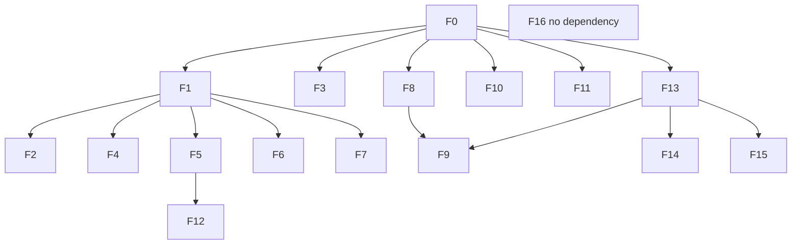

Date: 2026-10-24

# Initiative — Contrarian review remediation

**Status:** Proposed (plan recorded — Build only for finding ids named in a human message)

## Outcome

Close the gaps found in the 2026-10-24 contrarian review: unproven Flow effectiveness, an oversized skill lock, self-graded tests, no performance evidence, and fragile CI/test wiring. Keep what works (security layering, contract-as-code, honest implemented-vs-planned docs).

## Instructions for Cursor

1. Read `AGENTS.md`, `.agents/flow/flow.md` (Build, Review sections only), `.agents/flow/operations/verification.md`.
2. Work **one finding id at a time**, in wave order. Do not batch waves.
3. Build only the finding ids the human names in a message. Plan approval is not Build authorization.
4. Do not commit or push. Do not change an accepted ADR/PDR; if a finding needs it, stop and present the conflict and the ADR path.
5. After each finding: run the listed checks, report each command with its exit code, and state anything not run. A script that exits 0 without exercising the change is not evidence.
6. End every final response with the **Skills loaded** footer required by `.agents/flow/operations/skills.md`.

## Authorization

| Action | What authorizes it |
| --- | --- |
| This initiative document | Plan acceptance |
| Run a finding (`F0`–`F16`) | A later message that names that finding id |
| Live pilot (`F13`) | Message naming scenarios, arm, model, and session cap ([flow-improvement-loop.md](../../.agents/flow/initiatives/flow-improvement-loop.md)) |
| Skill-lock edits (`F8`) | Message that approves the removal list |
| Commit / push | Separate explicit request |

`F1` depends on a finished `F0`. If `pnpm qa` or `pnpm ci:local` is already red, stop and report; do not stack wiring changes on a broken baseline.

## Dependency graph



## Assumptions verified (task F0)

Evidence from static inspection (2026-10-24 planning) plus measured runs (see **F0 measurement table** below). Treat unchecked items until the table is filled.

### Static inspection (pre-measurement)

| Assumption | Result |
| --- | --- |
| Root `test` wiring | Four hand-written `pnpm --filter` calls (`@repo/genui`, `flow-app`, `@repo/db`, `@repo/flow-eval`). No `test` task in `turbo.json`. |
| Workspaces with tests vs root `test` | `web` has `test: "node -e process.exit(0)"`; Playwright specs live under `tests/browser/`. `@repo/ui` / `@repo/ts` have no unit tests. `flow-app` unit glob is `app/_lib/**/*.test.ts` only. Root `test:scripts` covers `scripts/*.test.mjs` and `tests/security/*.test.mjs`. |
| CI | Single `quality` job in `.github/workflows/ci.yml`; `permissions: contents: read`; checkout `actions/checkout@11d5960a326750d5838078e36cf38b85af677262`. `pnpm security:check` is in `ci:local` but not in CI. Gitleaks is installed in CI but not run there. |
| npm `cn` in `@repo/ui` | `cn@0.5.0` — compiled Tailwind class merge (documented drop-in for clsx + tailwind-merge). `packages/ui/src/lib/utils.ts` re-exports `cn` from `"cn"`. ~62 components import `"cn"` directly. Not the same as inlining `clsx` + `tailwind-merge` unless we switch implementations. |
| `shadcn` / `@shadcn/react` | `@shadcn/react` used at runtime in `message-scroller.tsx` and `questionnaire.tsx`. `shadcn` CLI package has no runtime import. |
| Skill lock vs routing table | 57 skills in `skills-lock.json`; 25 named in `.agents/flow/operations/skills.md` (all present in lock). 32 unreferenced in routing doc. No Expo / Reanimated / Framer Motion in app or workspace dependencies. |
| Knowledge snapshot | `knowledge-snapshot.ts`: **74,285 bytes**, 56 lines; eager import from `knowledge.ts`. ADR 0012: knowledge bundled at build time. |
| GenUI eval self-grade risk | `query-matrix.ts` prompts align with router keyword families; `query-matrix.test.ts` requires every case `PASS`; `eval:genui:offline` exits 1 on any failure. |
| Playwright compose | Only `genui-demo.spec.ts` mocks `/api/genui/compose`. Tier 1 compose is deterministic without `AI_GATEWAY_API_KEY`. Dev compose skips daily cap when rate limiting is off (`enforce-daily-cap.ts`). |
| Delegation tests | `D01`–`D15` assert `classifyDelegation` only (`flow.md` Enforcement). Evaluation-suite initiative does not state that plainly. |
| Coverage / bundle budget | No `experimental-test-coverage` usage; no bundle budget script. |

### F0 measurement table

Measured 2026-10-24 on this checkout. `pnpm qa` and `pnpm ci:local` chain with `&&`; the aggregate exits on the first failing step.

| Command | Exit code | Wall time (s) | Notes |
| --- | --: | --: | --- |
| `pnpm qa` | 1 | ~0.5 | Stops at `pnpm lint` (oxlint in `scripts/worktrees/**`) |
| `pnpm ci:local` | 1 | ~0.6 | Stops when `pnpm qa` fails |
| `pnpm flow-eval:check` | 0 | ~0.5 | Types, unit tests, `eval preserve` |

**`pnpm qa` steps (timed individually; full `qa` aborts before later steps when lint fails):**

| Step                              | Exit code | Wall time (s) |
| --------------------------------- | --------: | ------------: |
| `pnpm flow:check`                 |         0 |           0.1 |
| `pnpm architecture:check`         |         0 |           0.2 |
| `pnpm lint`                       |         1 |           0.2 |
| `pnpm knip`                       |         1 |           0.5 |
| `pnpm sherif`                     |         0 |           0.1 |
| `pnpm check-types`                |         1 |           0.2 |
| `pnpm test`                       |         0 |       0.7–1.4 |
| `pnpm --filter @repo/db db:check` |         0 |           0.2 |

**Remainder of `ci:local` (timed individually):**

| Step                      | Exit code | Wall time (s) |
| ------------------------- | --------: | ------------: |
| `pnpm flow:test`          |         0 |     under 0.1 |
| `pnpm architecture:test`  |         0 |     under 0.1 |
| `pnpm test:scripts`       |         0 |           2.0 |
| `pnpm eval:genui:offline` |         0 |           1.0 |
| `pnpm test:browser`       |         0 |          22.3 |
| `pnpm security:check`     |         0 |           3.4 |
| `pnpm build`              |         0 |           3.6 |

**Kill-criteria implication:** baseline `pnpm qa` is red (`lint`; `knip` and `check-types` also fail when run). Do not authorize **F1** until failures are triaged (pre-existing vs environment). Re-run `pnpm qa` after any baseline fix.

| Metric | Value | Notes |
| --- | --- | --- |
| `flow-app` `/` client JS (bootstrap sum) | 555,033 B (~542 KiB) | From `apps/flow/.next/build-manifest.json` (`rootMainFiles` + `/page` chunks + polyfill). Next.js 16.4 build log prints no First Load JS table. |
| `web` `/` client JS (bootstrap sum) | 554,893 B (~542 KiB) | Same method for `apps/web/.next/build-manifest.json` |
| Knowledge snapshot (source) | 74,285 B | `knowledge-snapshot.ts` on disk |
| Knowledge in server bundle | ~82 KiB tools chunk | `server/chunks/apps_flow_app__lib_flow-agent_tools_ts_*.js` (81,738 B); embeds bundled doc bodies. Snapshot size ≈90% of chunk |

**Skills:** 25 of 57 lock entries named in `.agents/flow/operations/skills.md`; 32 unreferenced (see F8 lists).

## Plan corrections (override brief conditionals)

These apply when the corresponding finding is authorized:

- **F3** — Keep `cn` and `@shadcn/react`. Move unused `shadcn` CLI to `devDependencies` only. If `pnpm knip` still flags it, stop and ask. Check: `pnpm knip`, `pnpm check-types`, `pnpm test:browser`.
- **F4** — New held-out prompt file (25–40 cases) + `test:held-out` script; expectations from product intent, not `routing.ts`; do not edit router in same change. Failures recorded here with proposed router fixes. Excluded from default `pnpm test` and `eval:genui:offline`.
- **F8** — Propose tier split only until removal list approved. **Proposed optional drop** (not in routing table, not in stack): `animate`, `animate-expo`, `animation-vocabulary`, `eas-app-stores`, `eas-update`, `eas-workflows`, `emilkowal-animations`, `expo-dev-client`, `expo-dom`, `expo-native-ui`, `expo-router`, `expo-upgrade`, `find-animation-opportunities`, `improve-animations`, `review-animations`. **Keep in optional/core debate until human input:** `apple-design`, `ask-sonner`, `better-auth-best-practices`, `core`, `emil-design-eng`, `eve`, `flow-eval`, `neon`, `nuqs`, `portless`, `react`, `react-email`, `turborepo`, `vercel-cli`, `vercel-composition-patterns`, `vitest`, `web-design-guidelines`. Every skill in `.agents/flow/operations/skills.md` routing table must remain in **core**.
- **F10** — Bundle budget from F0 baseline + margin; **advisory in CI** until open question 3 says hard fail. Parser unit-tested with fixture.
- **F11** — Refactor loading only if snapshot server-bundle share is material; keep `bundle-knowledge.mjs` on build for ADR 0012; do not edit ADR 0012; no hand-edits to snapshot.
- **F16** — Document that `D01`–`D15` test `classifyDelegation` as a **reference model** unless open question 4 chooses agent instructions.

## Waves

### Wave 1 — Cheap, safe, mechanical

#### F1 — Make test wiring automatic

- depends_on: [F0]
- writes: `package.json`, `turbo.json`, workspace `package.json` files
- Add a `test` task to `turbo.json`; give each package with tests a `test` script; make root `test` run `turbo run test`.
- Accept: adding a test in any workspace runs under `pnpm test` with no root edit. Prove with a temporary failing test (not committed).
- Check: `pnpm test`, `pnpm qa`.

#### F2 — Parallelize CI

- depends_on: [F1]
- writes: `.github/workflows/ci.yml`
- Split `quality` into jobs: `docs`, `static`, `unit`, `browser`, `build`. Keep pinned action SHAs and `permissions: contents: read`.
- Accept: doc link failure does not block type-check; report total wall time before/after locally.
- Check: `actionlint` if available; `pnpm ci:local`.

#### F3 — Dependency hygiene

- depends_on: [F0]
- writes: `packages/ui/package.json`, `pnpm-lock.yaml` (and devDeps move only unless knip forces stop)
- See **Plan corrections — F3** above.

### Wave 2 — Tests that can actually fail

#### F4 — Held-out GenUI query set

- depends_on: [F1]
- writes: `packages/genui/src/eval/` (new file), tests, package scripts
- See **Plan corrections — F4** above.
- Check: `pnpm --filter @repo/genui test`, `pnpm eval:genui:offline`, held-out script.

#### F5 — One real end-to-end path

- depends_on: [F1]
- writes: `apps/flow/tests/browser/` (new spec)
- Playwright spec without route mocking: Tier 1 prompt, real `/api/genui/compose` NDJSON, no model credentials.
- Accept: deleting compose route fails this spec while mocked specs still pass.
- Check: `pnpm test:browser:flow`.

#### F6 — Property/fuzz tests for the security boundary

- depends_on: [F1]
- writes: `packages/genui/src/contract/*.test.ts`, `apps/flow/app/_lib/security/*.test.ts`
- Seeded generator with `node:test`; compiler allowlist, bounded JSON reader, injection phrasing variants.
- Check: `pnpm test`.

#### F7 — Add coverage reporting (informational)

- depends_on: [F1]
- writes: workspace scripts, CI
- `node --test --experimental-test-coverage`; report only; CI summary; no threshold.

### Wave 3 — Skill setup

#### F8 — Trim and tier the skill lock (human decision required)

- depends_on: [F0]
- writes: `skills-lock.json`, `.agents/flow/operations/skills.md`, `docs/readme.md` (after approval only)
- See **Plan corrections — F8** above.
- Check: `pnpm flow:check`, `pnpm skills:install`.

#### F9 — Skill update regression gate

- depends_on: [F8, F13]
- writes: `.agents/flow/operations/skills.md`
- Document `pnpm skills:update` → deterministic eval → live pilot (when available) before accepting new hashes.

### Wave 4 — Performance evidence

#### F10 — Bundle budget

- depends_on: [F0]
- writes: CI, `scripts/check-bundle-size.mjs` + test
- See **Plan corrections — F10** above.

#### F11 — Knowledge snapshot cost

- depends_on: [F0]
- writes: `apps/flow/scripts/bundle-knowledge.mjs`, `apps/flow/app/_lib/flow-agent/knowledge.ts` (only if material)
- See **Plan corrections — F11** above.

#### F12 — Model path measurements

- depends_on: [F5]
- writes: `apps/flow/scripts/`, docs note
- Manual script; not CI; record p50/p95 only when measured with credentials.

### Wave 5 — Flow itself (human authorization per item)

#### F13 — Run the live pilot

- depends_on: [F0]
- Requires human message with scenarios, arm, model, session cap. Do not start autonomously.

#### F14 — Slim the entry point

- depends_on: [F13]
- writes: `AGENTS.md`, `.agents/flow/flow.md`
- Target ~40 lines in `AGENTS.md` from pilot evidence only.

#### F15 — Enforce, don't just instruct

- depends_on: [F13]
- CI gate for mechanical rules (e.g. `packages/db` / `docker-compose.yml` changes need accepted ADR reference in PR).

#### F16 — Clarify what `D01`–`D15` prove

- depends_on: []
- writes: `.agents/flow/flow.md` (Enforcement), `.agents/flow/operations/delegation.md`, `docs/initiatives/flow-evaluation-suite.md`
- See **Plan corrections — F16** above.

## Out of scope

- Replacing Next.js, Drizzle/Postgres, or the monorepo stack (ADR 0001).
- Changing the security model.
- Rewriting the UI package.

## Validation (end of each wave)

```bash
pnpm qa
pnpm ci:local
pnpm flow-eval:check
```

Report each command with its exit code. Anything not run is stated as not run.

## Kill criteria

- Baseline `qa` or `ci:local` failing after F0: stop before F1+.
- Snapshot server-bundle share small: skip F11 refactor.
- Removal list drops a routing-table skill: reject that name.
- Change requires new/superseding ADR: stop and present ADR path.

## Open questions for the human

1. Which Expo and animation skills, if any, are actually in use?
2. Which model should the live pilot use?
3. Is a bundle budget acceptable as a hard CI failure, or advisory first? (Default: advisory.)
4. Should `classifyDelegation` become instructions to agents, or stay a reference model? (Default: reference model.)

## Progress

- [x] Initiative recorded (this document)
- [x] F0 — baseline measurements appended (2026-10-24)
- [ ] F1–F16 — **blocked:** no finding id was named for Build in the plan-implementation message; authorize one id per message in wave order

## Build authorization log

| Finding | Authorized                               | Completed  |
| ------- | ---------------------------------------- | ---------- |
| F0      | Plan implementation (measure + document) | 2026-10-24 |
| F1–F16  | —                                        | —          |

## Findings from held-out eval (F4)

_None until F4 is authorized and run._
