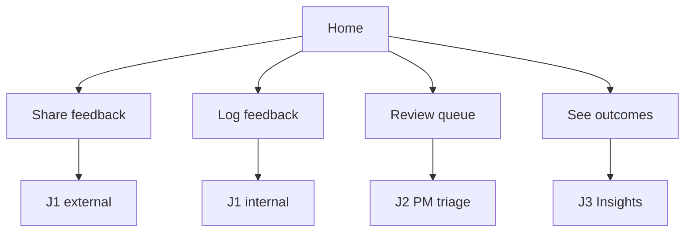

# Spec: Feature Intelligence — user journeys

**Last reviewed:** 2026-10-25  
**Status:** Current  
**Version:** v1.3 (AI UX patterns)  
**Contracts:** [DESIGN.md](../../DESIGN.md) · [GLOSSARY.md](../../GLOSSARY.md) · [feature-intelligence.md](./feature-intelligence.md) (metrics)  
**UI stack:** `@repo/ui` + Tailwind tokens — **not** GenUI for core FI flows.

Domain terms stay in [GLOSSARY.md](../../GLOSSARY.md) and code; **UI copy is persona-appropriate** (plain language for submitters, precise terms for PMs).

---

## Personas and what they need

| Persona | Who | Primary job | Success feeling | Avoid |
| --- | --- | --- | --- | --- |
| **External submitter** | Customer, prospect | “My feedback was heard without repeating myself” | Quick submit, optional link to existing idea | PM jargon, metrics dashboards, triage queue |
| **Internal submitter** | Support, sales, internal | “I didn’t create another duplicate ticket” | Fast paste, strong duplicate nudge | Writing problem statements from scratch |
| **Product manager** | PM (demo hero) | “I decided with evidence, quickly” | Queue → decide → queue shrinks | Re-reading raw threads, blank rationale |
| **Product leader** | PM lead, stakeholder | “I trust how decisions are made” | Metrics + audit trail | Submit flows, disposition controls |

**Source** (`customer` | `prospect` | `support` | `internal`) tags the request for analytics; use it to **pre-fill** submit UX (see [J1 variants](#j1--submit--confirm-streamlined-by-persona)).

---

## Streamlined experience principles

1. **Home routes intent, not features** — four persona cards instead of flat equal nav (see [Home — persona router](#home--persona-router)).
2. **Progressive disclosure** — submitters see 2–3 preview blocks; PMs see brief + disposition; leaders see insights + audit, not submit.
3. **One hero metric per persona moment** — submitter: “Ready in Xs”; PM: open queue count; leader: capture rate trend (session delta).
4. **Same backend, different surfaces** — `@repo/fi` unchanged; UI hides fields by route/persona context.
5. **Nav highlights the next action** — PM sees **Triage (N)** badge; submitters never need Insights in primary nav.
6. **AI UX patterns** — progress labels, time estimate, human confirm gates, and failure copy align with [AI UX Playground](https://www.aiuxplayground.com/patterns) via [feature-intelligence-ai-ux-patterns.md](./feature-intelligence-ai-ux-patterns.md) (web + eve + `/chat`).

---

## Home — persona router

**Route:** `/`  
**Goal:** Send each persona to the shortest path in one click.

| Card / CTA | Copy (user-facing) | Goes to | Primary persona |
| --- | --- | --- | --- |
| **Share feedback** | “Tell us what you need” | `/requests/new?context=external` | External (+ optional internal) |
| **Log customer feedback** | “Paste ticket or note — we’ll check duplicates” | `/requests/new?context=internal` | Internal submitter |
| **Review queue** | “Decide what we do next” + badge `openQueueCount` | `/triage` | PM |
| **See outcomes** | “How decisions are trending” | `/insights` | Leader |

Secondary link: **Browse all requests** → `/requests` (J4).

**Nav (persistent):** Browse · Submit · **Triage** (badge when PM path) · Insights. Hide **Insights** from submit-only sessions optional v2; MVP: keep but de-emphasize in external flow success screen.



---

## Journey map (by persona)

| Persona | Streamlined path | Steps (max) | Metrics touched |
| --- | --- | --- | --- |
| External submitter | Home → Submit → Confirm → Thank-you | 3 screens | Readiness, intake link |
| Internal submitter | Home → Submit (dupes first) → Confirm | 3 screens | Intake link |
| PM | Home/Triage → Review → Disposition | 2 per item | Capture, PM effort |
| Leader | Home → Insights → optional detail audit | 2 | All four readout |

**Demo script (recording direction only):** Leader glance at Insights → PM Triage (2 dispositions) → Insights refresh → optional external Submit live. **Not** a product feature—use any external recorder; no Loom embed or in-app capture.

---

## J1 — Submit & confirm (streamlined by persona)

**Shared backend:** harness + `confirmRequest`. **Metrics:** readiness time; intake link on confirm.

### External (`?context=external`)

| Step | What they see | Hidden / collapsed |
| --- | --- | --- |
| 1 Form | Title, “What’s going wrong or missing?” (`Textarea`), source default **customer** (change in advanced) | Theme registry keys |
| 2 Loading | “Checking for similar feedback…” | Model names |
| 3 Confirm | **“We heard this as:”** editable one-liner; **Similar ideas** radio (link or none); primary **Submit feedback** | Decision brief, theme rationale, transparency |
| 4 Done | Thank-you `Card`: “We’ll consider this with other feedback.” Link **View your submission** (J5 lite) | Insights, Triage |

**Copy:** Use “feedback” / “need”, not “feature request” or “problem statement” in headings (glossary term in DB only).

### Internal (`?context=internal`)

| Step | What they see | Hidden / collapsed |
| --- | --- | --- |
| 1 Form | Title optional; large **paste** `Textarea`; source `Select` default **support** | — |
| 2 Loading | Same | — |
| 3 Confirm | **Duplicates first** (expanded by default if any candidate); problem one-liner editable; **Link to existing** pre-selected when score high | Decision brief collapsed under “PM summary” |
| 4 Done | “Linked to FR-…” if linked; CTA **Back to queue** for support role → `/requests` filtered | — |

### PM / leader on submit route

- Redirect or banner: “Submitting feedback? Use **Share feedback** from home.” PMs rarely submit in demo; no block if they land on `/requests/new`.

### Preview stack (implementation reference)

| Block | External | Internal | PM-only detail |
| --- | --- | --- | --- |
| Editable need | ✓ prominent | ✓ | stored as `problem_statement` |
| Similar / duplicate | ✓ if any | ✓ **first** | intake link |
| Theme | Badge only | Badge | `theme_label` |
| Decision brief | ✗ | Collapsed | ✓ full on J2/J5 |
| Transparency | ✗ | ✗ | ✓ J5 collapsible |

### Errors

Same as v1; external copy: “Something went wrong — you can still submit” on degraded harness.

---

## J2 — PM triage (hero, streamlined)

**Goal:** Minimum clicks from queue → recorded **disposition**.  
**Metrics:** `pm_review_started_at`, disposition timestamps, capture rate.

### Streamlining

| Before (v1) | After (v1.1) |
| --- | --- |
| Generic table | **Sorted by support**; top row = “Start here” visual hint |
| Full dialog always | **Expand row** inline: brief + problem + dupes; disposition at bottom of same panel |
| Empty rationale | **Pre-filled** from `dispositionSuggestion`; PM edits or accepts |
| Nav discover | PM lands on `/triage` from home card; badge shows `openQueueCount` |

### Steps

1. `/triage` — scan list (title, support count, theme badge, age).
2. **Review** — expand row → `recordPmReviewStarted` (once).
3. Choose disposition `Select` + rationale `Textarea` + merge target if needed.
4. **Save** — row removed; toast “Decision recorded” (optional).
5. Repeat; empty queue CTA → **Insights**.

**Language:** Use glossary terms here: **Disposition**, **Merge**, **Monitor**, **Decline**, **Needs discussion**.

**Demo:** Two items from queue; then J3.

---

## J3 — Insights (leader + PM, streamlined)

**Persona split on same page:**

| Section | Leader (primary) | PM (primary) |
| --- | --- | --- |
| Top | Capture rate + intake link rate (narrative subtitles) | **Open queue** large + **Go to triage** |
| Grid | All four metrics | Readiness + PM effort |
| Footer | Link sample requests / audit example | Session note: “Updated after your last disposition” |

Leaders **read-only** — no disposition CTAs on this page.

---

## J4 — Discover & support (shared, light)

**Personas:** Internal submitter (check before log), external (see what exists), PM (low priority).

- Default sort: **most supported**.
- **Support** button — verb “I want this too” (external), “+1 customer ask” (internal tooltip).
- No disposition UI on list.

---

## J5 — Request detail (persona views)

| Persona | Default sections visible |
| --- | --- |
| External | Need, status “Submitted”, related link if any |
| Internal | + raw paste, support count |
| PM / leader | + decision brief, disposition audit, **How we evaluated** collapsible |

Single route; **no role auth in MVP** — use `?view=pm` optional query for demo to expand audit sections.

---

## J6 — Ask-only chat (deferred)

Persona: **anyone confused by process**. Answers “what happens to my feedback?” — never executes FI actions.

---

## Cross-persona boundaries

| Surface | External | Internal | PM | Leader |
| --- | --- | --- | --- | --- |
| `/triage` | Omit from success CTAs | Optional link | Primary | View only (no save) |
| `/insights` | Omit | Omit | Secondary | Primary |
| Decision brief on submit | Hidden | Collapsed | — | — |
| Disposition controls | ✗ | ✗ | ✓ | ✗ (MVP) |
| Glossary-heavy labels | ✗ | Light | ✓ | ✓ |

---

## Global UX rules (updated)

- **One primary action** per screen.
- **Persona copy** over literal glossary in submitter UI; glossary still drives API/DB.
- **Server-first** + a11y unchanged from v1.
- **Metrics honesty** on Insights unchanged.

### App chrome

- Home logo → persona router.
- `openQueueCount` badge on **Triage** nav item when &gt; 0.

---

## UI detail (design system)

**Stack:** Next.js App Router (RSC loaders + server actions), `@repo/ui` primitives, **Meta CTO** semantic tokens from `packages/ui/src/styles/globals.css` ([DESIGN.md](../../DESIGN.md), [metacto.com](https://www.metacto.com/)). **No GenUI** on core FI flows. Compose with existing primitives before new variants.

### App shell

| Region | Component / pattern | Behavior |
| --- | --- | --- |
| **Header** | `border-b bg-background/95 backdrop-blur supports-[backdrop-filter]:bg-background/60` | Sticky top; `z-40` |
| **Brand** | Text link “Feature Intelligence” + `text-muted-foreground` subtitle one line | Subtitle hidden below `sm` |
| **Nav** | `NavigationMenu` or horizontal `Button variant="ghost" size="sm"` cluster | Items: Browse · Submit · Triage · Insights |
| **Triage badge** | `Badge variant="secondary"` on Triage only when `openQueueCount > 0` | Show count; `aria-label` “{n} items in triage queue” |
| **Main** | `mx-auto w-full px-4 py-6` | Width per route (below) |
| **Theme** | Existing `ThemeProvider` + `d` hotkey | Unchanged from starter |

**Nav emphasis:** On `/`, nav is secondary to persona cards. On workflow routes, current section uses `font-medium text-foreground`; others `text-muted-foreground`.

### Layout widths

| Route | `max-w` | Notes |
| --- | --- | --- |
| `/` | `max-w-3xl` | 2×2 persona card grid at `md+` |
| `/requests/new` | `max-w-xl` | Single column; comfortable form measure |
| `/requests`, `/requests/[id]` | `max-w-4xl` | List cards; detail two-column at `lg` |
| `/triage` | `max-w-5xl` | Queue needs horizontal space for inline panel |
| `/insights` | `max-w-4xl` | Metric grid 2×2 at `sm+` |
| `/chat` | `max-w-2xl` | Narrow thread (deferred) |

### Home — persona cards

- **Grid:** `grid gap-4 sm:grid-cols-2` inside `FieldGroup`.
- **Card:** `Card` + `CardHeader` (title + one-line description) + `CardFooter` with single `Button` `className="w-full"` (entire card not clickable—explicit CTA only for a11y).
- **PM card:** Footer row: `Button` + optional `Badge` beside title “Review queue” when `openQueueCount > 0`.
- **Browse:** `text-sm text-muted-foreground` link below grid, not a fifth card.

**Iconography (optional, lucide):** MessageSquare (external), ClipboardPaste (internal), ListChecks (PM), LineChart (leader)—`EmptyMedia variant="icon"` scale in card header only; keep icons muted so copy leads.

### J1 — Submit UI states

Use a **3-step stepper** (text only, no wizard chrome): `Form` → `Review` → `Done`. Show as `text-xs text-muted-foreground` with current step `text-foreground font-medium`. Do not block back navigation on Review.

| State | UI | Components |
| --- | --- | --- |
| **Form** | `Field` + `FieldLabel` + `Input` / `Textarea` | External: title required; internal: paste `Textarea` `min-h-40` |
| **Source** | External: hidden in `Collapsible` “More options” | Internal: `Select` visible, default support |
| **Loading** | Centered `Spinner` + **stage label** + estimate “Usually 10–20s” | `aria-live="polite"`; stages: similar → theme → classify → summary ([pattern spec](./feature-intelligence-ai-ux-patterns.md#triage-progress-feedback-shared-web--agent)) |
| **Review** | `Card` stack `gap-3` | See preview stack table above |
| **Similar ideas** | `RadioGroup` in `FieldSet` | Each option: title + one-line problem; `FieldDescription` score as “Strong match” / “Possible match” (no raw floats in external) |
| **Primary CTA** | External: “Submit feedback”; Internal: “Confirm & publish” | `Button` full width on mobile |
| **Degraded** | `Alert` variant default + same CTA enabled | External friendly copy |
| **Done** | `Card` thank-you + `Button variant="outline"` secondary | External: no nav to Triage/Insights |

**Internal PM summary:** `Collapsible` trigger “PM summary” → decision brief excerpt in `text-sm text-muted-foreground`.

### J2 — Triage UI (inline panel)

**Prefer inline expand over modal** — disposition stays in context; dialog only for destructive confirm if needed later.

| Element | Desktop (`md+`) | Mobile |
| --- | --- | --- |
| Queue | `Table` with `TableRow` clickable | `Item` / `ItemGroup` same data |
| Expand | `Collapsible` or single-open `Accordion` per row | Full-width panel below row |
| “Start here” | `Badge variant="outline"` on highest-support row | Same |
| Row summary | Title, `Badge` theme, support count, relative age | Truncate title `max-w-[12rem]` |
| Panel body | `Separator` then problem + brief (`prose-sm` or `text-sm`) | Stack vertically |
| Dupes | `Item` links to `/requests/[id]` | — |
| Disposition | `Field` + `Select` + `Textarea` `min-h-24` | Sticky footer `Button` “Save disposition” optional |
| Empty queue | `Empty` + `EmptyTitle` “Queue clear” + link Insights | — |
| After save | `toast` “Decision recorded” | Remove row without full page reload if action returns |

**Focus:** On expand, move focus to panel heading (`tabIndex={-1}` ref) for keyboard users.

**Leader view-only:** Same layout; hide Save; show `text-muted-foreground` banner “View only in this demo.”

### J3 — Insights UI

| Block | Leader | PM |
| --- | --- | --- |
| **Hero** | `Card` spanning 2 cols: capture rate % + narrative subtitle | `Card`: large `openQueueCount` + `Button` → `/triage` |
| **Grid** | Four metric `Card`s: label, formatted value, `text-xs` footnote with `n` | Readiness + PM effort cards only (2-col) |
| **Charts** | **None in MVP** — numbers + subtitles only (`Chart` deferred) | — |
| **Honesty** | Footnote when `pmTriageN < 2` under PM effort card | Same proxy rule as [feature-intelligence.md](./feature-intelligence.md) |
| **Session delta** | Optional `text-muted-foreground` “Since you opened this page” if `computedAt` refresh | PM footer copy per persona table |

Format durations: human-readable (`2.4s`, `18m`) via shared formatter in `apps/web` route-local util.

### J4 — Discover

- **Filters:** `native-select` or `Select` for `theme_key`; sort as second control.
- **Cards:** `Card` clickable whole surface (`<Link>` wrapper) — title, problem one-liner, `Badge` theme, support count, source pill.
- **Support on detail:** `Button variant="secondary"`; external label “I want this too”; disable after session support with `text-muted-foreground` “You supported this.”

### J5 — Detail layout

```
lg:grid lg:grid-cols-[1fr_280px] lg:gap-8
```

| Column | Content |
| --- | --- |
| Main | Need/problem, description, status line |
| Sidebar | Support CTA, disposition audit (PM), `Collapsible` “How we evaluated” |

**`?view=pm`:** Open audit + transparency `Collapsible` by default; external paths omit sidebar sections server-side when `context` known from referrer optional v2.

### Motion and loading

- **Skeleton:** Triage queue initial load only (`Skeleton` rows × 5).
- **Submit:** Spinner only (no skeleton on form).
- **Transitions:** No route transition animations; `Collapsible` uses default duration.
- **Toast:** Disposition success only (keep demo calm).

### Accessibility checklist (FI)

- Every screen one visible `<h1>` matching persona copy (e.g. external submit: “Share feedback”, not “New feature request”).
- Loading strings in `aria-live="polite"`.
- Disposition `Select` + `Textarea` associated via `FieldLabel` / `htmlFor`.
- Theme filter and disposition controls keyboard-operable; merge target `Combobox` only if list &gt; 8 else `Select`.
- Color: status never rely on color alone—pair Badge with text (“Monitor”, “Declined”).

### Responsive summary

| Breakpoint | Change                                                       |
| ---------- | ------------------------------------------------------------ |
| `< sm`     | Single column; triage table → items; sticky disposition save |
| `sm–md`    | Insights 2-col grid                                          |
| `lg+`      | Detail sidebar; triage table + wide inline panel             |

### Anti-patterns (this product)

- Chat bubble UI on submit or triage.
- GenUI / model-generated layout for metrics or forms.
- Multiple primary buttons per screen.
- Showing raw harness JSON or model IDs to external users.
- Dialog-first triage (v1.1+ uses inline panel).

---

## Journey ↔ implementation checklist

| Journey | Routes | Persona focus | Manual test |
| --- | --- | --- | --- |
| J1e | `/requests/new?context=external` | External | W-2e simplified copy |
| J1i | `/requests/new?context=internal` | Internal | W-3 dupes first |
| J2 | `/triage` | PM | W-5 |
| J3 | `/insights` | Leader / PM | W-7 |
| J4–J6 | unchanged | — | W-4, W-6, W-8 |

Update [feature-intelligence-testing.md](./feature-intelligence-testing.md) when implementing persona variants.

## Verification

P0 **persona paths:** external submit thank-you (no triage link); PM triage two items; leader insights before/after. Agent-browser dogfood per [verification.md](../../.agents/flow/operations/verification.md).

## Changelog

- **v1.2** — UI detail: app shell, layout widths, component mapping, triage inline panel, Insights stat cards (no charts), a11y and responsive rules.
- **v1.3** — AI UX Playground alignment: triage stage progress, pattern spec cross-link.
- **v1.1** — Persona router home, progressive disclosure on J1, inline PM triage, leader vs PM Insights layout, cross-persona boundary table.
