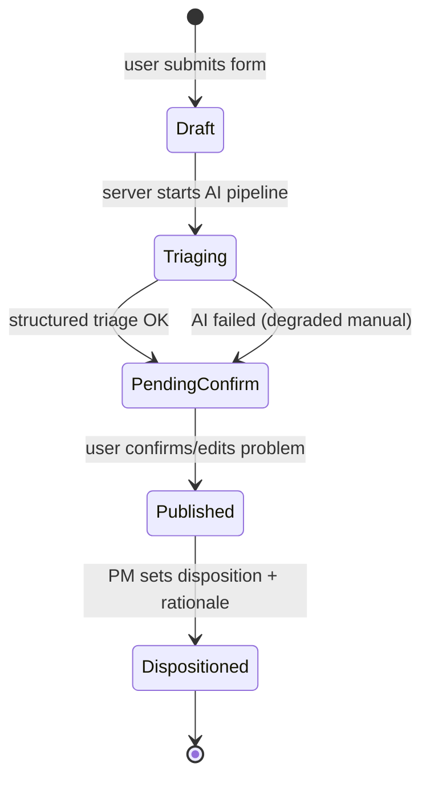

# Spec: Feature Intelligence (assessment slice)

**Last reviewed:** 2026-10-25  
**Status:** Current  
**Initiative:** [feature-intelligence.md](../initiatives/feature-intelligence.md)  
**Ubiquitous language:** [GLOSSARY.md](../../GLOSSARY.md)  
**User journeys (UX):** [feature-intelligence-journeys.md](./feature-intelligence-journeys.md) (v1.3)

### Specification index

| Document | Scope |
| --- | --- |
| [feature-intelligence-journeys.md](./feature-intelligence-journeys.md) | Personas, persona router home, UI detail, demo script (recording direction) |
| [feature-intelligence-ai-ux-patterns.md](./feature-intelligence-ai-ux-patterns.md) | AI UX Playground mapping (web, eve, `/chat`) |
| [feature-intelligence-eve-agent.md](./feature-intelligence-eve-agent.md) | eve operator, tools, AG-1–AG-7 |
| [feature-intelligence-triage-harness.md](./feature-intelligence-triage-harness.md) | T0–T3 pipeline, Jev, synthesis |
| [feature-intelligence-seed.md](./feature-intelligence-seed.md) | 500-row seed + anchors |
| [feature-intelligence-analytics.md](./feature-intelligence-analytics.md) | Insights trends |
| [feature-intelligence-testing.md](./feature-intelligence-testing.md) | TDD order, W-* manual, eve evals |
| [docs/tasks/feature-intelligence.md](../tasks/feature-intelligence.md) | Build checklist (separate from specs) |
| [ADR 0003](../adr/0003-feature-intelligence-model-providers.md) | Gateway (Jev/triage) vs Anthropic (`/chat`) |

## Problem

Product teams drown in unstructured feature requests from **customers, prospects, support, and internal stakeholders**. Manual triage fails to consolidate duplicates, surface underlying problems, or record decisions—so prioritization is inconsistent and stakeholders stay uninformed.

## Solution summary

An **AI intake gate** structures every submission before it enters the catalog; a **PM triage queue** turns structured artifacts into **dispositions** (merge, monitor, decline, discuss). Discovery and support stay familiar; the workflow change is **decision-ready by default**.

**Agents:** The same capabilities are exposed to **eve** through typed tools over **`@repo/fi`** ([eve agent spec](./feature-intelligence-eve-agent.md)). The **starter chat** remains **ask-only** (no FI tools)—not the primary workflow.

---

## Architecture

```text
apps/web (human UI, ask-only /api/chat)
       \
        → @repo/fi ← agent/tools/* (eve)
              \
               → @repo/db
```

- **Human workflow:** pages and server actions call `@repo/fi` only.
- **Agent workflow:** eve tools call the same functions (PDR 0001 capability-first).
- **Triage harness** lives in `@repo/fi/triage` ([spec](./feature-intelligence-triage-harness.md)): Jev classification + structured synthesis; invoked by web and `submit_request`.

---

## Information architecture

| Route | Purpose | Primary user |
| --- | --- | --- |
| `/` | **Persona router** — four intent cards + Browse secondary | All |
| `/requests` | Discover list (filter, sort, support) | Internal submitter, PM |
| `/requests/new` | Submit → AI triage → confirm → publish (`?context=external\|internal`) | Submitters |
| `/requests/[id]` | Detail; sections vary by persona / `?view=pm` | All |
| `/triage` | PM queue; inline expand disposition | PM (leader view-only) |
| `/insights` | North-star metrics; leader hero vs PM queue CTA | Leader, PM |
| `/chat` | **Ask-only** product Q&A (no tools, no mutations) | Any — **implemented** (Anthropic key) |

No authentication in this slice; **source** on submit replaces identity. Eve HTTP sessions use separate auth policy per [eve agent spec](./feature-intelligence-eve-agent.md).

---

## Request lifecycle



- **Decision-ready:** enters at `PendingConfirm` (brief complete) or `Published` if confirm step skipped in Plan (default: **require confirm** for demo narrative).
- **Triage queue** includes `Published` with `disposition = null`.

---

## User flows

### F1 — Submit with AI gate (submitter)

1. Open `/requests/new`; enter title, description, optional source.
2. Client calls server action or API → create `Draft`, run triage.
3. Show loading with **stage labels** and “Usually 10–20s” estimate ([AI UX patterns](./feature-intelligence-ai-ux-patterns.md#triage-progress-feedback-shared-web--agent)).
4. Present **triage preview**: problem statement (editable), theme, duplicate candidates, confidence, decision brief excerpt; optional **“Link to existing request”** (pre-select harness `link_duplicate` when not `none`).
5. User edits problem if needed → **Confirm & publish** (persists `intake_linked_request_id` when linking).
6. **Post-confirm routing (persona):**
   - **External** (`?context=external`): **Thank-you** step on submit flow—no redirect to detail, no decision brief or transparency panel ([journeys](./feature-intelligence-journeys.md#j1--submit-ui-states)).
   - **Internal** (`?context=internal`): Redirect to `/requests/[id]` with full transparency panel.

**Success:** **Decision readiness** timer stops at `triage_completed_at` (see [§ Product metrics](#product-metrics-first)).

### F2 — Discover and support

1. `/requests` lists cards: title, problem one-liner, theme chip, support count, source, disposition badge if any.
2. Filter by theme; sort by support (default) or newest.
3. On detail, **Support** increments count (idempotent per browser via **cookie `supporter_id`**).

### F3 — PM triage (hero)

1. `/triage` lists published items without disposition, sorted by support then age.
2. Row shows decision brief, duplicate links, theme, readiness age.
3. Opening triage detail sets **`pm_review_started_at`** on first view (server action `recordPmReviewStarted`).
4. PM chooses disposition, optional merge target, rationale (pre-filled from harness **disposition hint** when present).
5. Save → item leaves queue; audit visible on detail.

**Success:** **PM triage effort** measurable via `disposition_at - pm_review_started_at`; **decision capture** via disposition + rationale.

### F4 — Near-duplicate demo

1. Seed includes “Export to CSV” and “Download CSV report” style pair.
2. Live submit overlapping wording → triage returns candidate with explanation → submitter links at confirm or PM merges in triage.

---

## Data model (`@repo/db` / Postgres)

New tables in `packages/db` (product schema; migration `0002_feature_intelligence.sql`).

### `feature_request`

| Column | Type | Notes |
| --- | --- | --- |
| `id` | uuid PK |  |
| `title` | text | Raw submitter title |
| `description` | text | Raw description |
| `source` | enum | `customer`, `prospect`, `support`, `internal` |
| `status` | enum | `draft`, `triaging`, `pending_confirm`, `published`, `archived` |
| `problem_statement` | text | AI + human-edited |
| `theme_key` | text | Registry key (`reporting_exports`, …)—**filterable**; never free-text |
| `theme_label` | text | Display label from registry (denormalized) |
| `theme_rationale` | text |  |
| `decision_brief` | text | PM-oriented paragraph |
| `triage_confidence` | real | 0–1 optional |
| `triage_steps` | jsonb | Transparency payload (see below) |
| `canonical_request_id` | uuid FK nullable | PM **merge** disposition only (see [linking model](#linking-model)) |
| `disposition` | enum nullable | `merge`, `monitor`, `decline`, `needs_discussion` |
| `disposition_rationale` | text nullable |  |
| `merge_target_id` | uuid FK nullable | When disposition = merge |
| `intake_linked_request_id` | uuid FK nullable | Set on **confirm** when submitter links to existing need ([intake link rate](#product-metrics-first)) |
| `submitted_at` | timestamptz | Form post; start of decision readiness |
| `triage_completed_at` | timestamptz nullable | End of decision readiness (harness done, preview shown) |
| `published_at` | timestamptz nullable | After confirm |
| `pm_review_started_at` | timestamptz nullable | First PM open from `/triage` or detail |
| `disposition_at` | timestamptz nullable | End of PM triage effort |

### `feature_request_duplicate_candidate`

| Column                 | Type    | Notes             |
| ---------------------- | ------- | ----------------- |
| `id`                   | uuid PK |                   |
| `request_id`           | uuid FK | New request       |
| `candidate_request_id` | uuid FK | Existing          |
| `score`                | real    | Similarity        |
| `explanation`          | text    | Model or template |

### `feature_request_support`

| Column | Type | Notes |
| --- | --- | --- |
| `request_id` | uuid FK |  |
| `supporter_key` | text | Cookie-derived |
| PK | (request_id, supporter_key) | One support per supporter per request |

### `triage_steps` JSON shape (transparency)

```json
{
  "version": 1,
  "steps": [
    {
      "name": "retrieve_candidates",
      "detail": "Top 10 by lexical similarity (assessment default)"
    },
    { "name": "extract_problem", "detail": "Model: …" },
    { "name": "assign_theme", "detail": "…" },
    { "name": "compose_brief", "detail": "…" }
  ],
  "model": "<model id>",
  "duration_ms": 4200
}
```

**Storage:** Postgres via `@repo/db`. **Duplicate retrieval (assessment):** lexical top-10 only—no pgvector in MVP ([initiative MVP cut](../initiatives/feature-intelligence.md#mvp-cut-line-assessment)).

---

## Linking model

Two distinct links—do not conflate in UI or metrics.

| Mechanism | Who | When | Column | User-visible effect |
| --- | --- | --- | --- | --- |
| **Intake link** | Submitter | **Confirm** after triage | `intake_linked_request_id` | New row stays published; detail shows “Related to FR-00x”; counts **intake link rate** |
| **PM merge** | PM | **Disposition** = `merge` | `merge_target_id`, optional `canonical_request_id` on source | Source may hide or redirect; audit trail on both rows; does **not** replace intake link metric |

- Intake link does **not** auto-merge rows or dedupe support counts in MVP.
- PM may still `merge` after intake link if strategy changes.
- List filters use `theme_key`, not `theme_label` text search.

---

## AI triage pipeline

Server-only; canonical design: **[feature-intelligence-triage-harness.md](./feature-intelligence-triage-harness.md)**.

Summary: **T0 retrieve** → **T1** theme fast-path → **T2 `experimental_decide` (Jev via AI Gateway)** for theme (if needed), `link_duplicate`, `is_solution_shaped` → **T3 `generateObject` (gateway)** for problem statement + brief → persist candidates + `triage_steps`. Provider split: [ADR 0003](../adr/0003-feature-intelligence-model-providers.md).

**Degraded path:** No gateway key or timeout → deterministic theme + description as problem; banner in UI.

**Human judgment:** Disposition hint from harness is **display-only** until PM `setDisposition`.

---

## API / server actions

All operations delegate to **`@repo/fi`** (shared with eve tools).

| Operation | Style | Notes |
| --- | --- | --- |
| `createAndTriageRequest` | Server action | → `createDraftAndTriage` |
| `confirmRequest` | Server action | → `confirmRequest` (problem edit, optional `intakeLinkedRequestId`) |
| `recordPmReviewStarted` | Server action | → sets `pm_review_started_at` once |
| `getInsights` | RSC / action | → `getInsights` (metric formulas below) |
| `listRequests` | RSC loader / action | → `searchRequests` |
| `getRequest` | RSC | → `getRequest` |
| `supportRequest` | Server action | Cookie → `supportRequest` |
| `setDisposition` | Server action | → `setDisposition` |
| `seedDemoData` | Script or dev-only route | Idempotent seed |
| `POST /api/chat` | Route handler | Ask-only `streamText`; **no** `@repo/fi` in v1 |

Rate-limit triage per IP in memory for assessment (optional).

---

## UI specification

See [DESIGN.md](../../DESIGN.md#feature-intelligence--screens-accepted). Summary:

- **Nav:** Browse · Submit · Triage (badge) · Insights; home is persona card router ([journeys](./feature-intelligence-journeys.md)).
- **Triage preview:** Card stack—problem editor prominent; dupes as `RadioGroup`; primary CTA persona-specific.
- **Triage queue:** Table / `Item` list; **inline expand panel** for disposition + merge `Select`; see [journeys UI detail](./feature-intelligence-journeys.md#ui-detail-design-system).
- **Transparency:** Collapsible “How this was evaluated” on detail.
- **Insights:** Four **north-star** cards (readiness, PM triage, capture rate, intake link rate)—see [§ Product metrics](#product-metrics-first). Subtitle shows formula + sample size `n`.

Use `@repo/ui` Button, Input, Textarea, Select, Card, Badge, Dialog, Collapsible.

---

## Edge cases

| Case | Behavior |
| --- | --- |
| Empty description | Block submit with validation |
| AI timeout (>20s) | Degraded triage + retry button |
| No published requests yet | Skip retrieve; model only |
| Merge disposition without target | Validation error |
| Support on merged canonical | Support applies to canonical id (redirect or store on canonical) |
| Re-triage | Not in scope; PM edits problem on detail manually optional nice-to-have |

---

## Non-functional

- **Security:** Structured outputs only; no GenUI for core triage; sanitize user markdown display.
- **Performance:** Target p95 triage &lt;15s; show progress UI.
- **Observability:** `triage_steps.duration_ms`; metrics computed from DB columns below (not client timers).

---

## Product metrics (first)

Build and UX choices **prioritize measurable north-star metrics** over auxiliary harness signals (priority in brief text uses **support count**, not a separate urgency score).

### Definitions

| Metric | Definition | Numerator / denominator | Primary timestamps / columns |
| --- | --- | --- | --- |
| **Decision readiness time** | Submit → decision-ready | Per request: `triage_completed_at - submitted_at` | `submitted_at`, `triage_completed_at` |
| **PM triage effort** | PM review → disposition | Per request: `disposition_at - pm_review_started_at` | `pm_review_started_at`, `disposition_at` |
| **Decision capture rate** | Backlog **closure** (moves on demo) | `#(disposition + non-empty rationale)` / `#(that + open queue)` where **open queue** = published, no disposition | `disposition`, `disposition_rationale`, `status` |
| **Intake link rate** (supporting) | Linked at submit confirm | `#(published AND intake_linked_request_id NOT NULL)` / `#(published)` | `intake_linked_request_id`, `published_at` |

**Published** = `status = 'published'`. Denominators exclude `draft`, `archived`.

**Why capture rate uses open queue:** Seed already has 2 dispositioned rows; dividing by all published makes the rate static. **Open-queue denominator** makes dispositions in a **live demo** visibly move the metric.

**Proxy (PM triage only):** `medianPmTriageMsProxy` = `disposition_at - published_at` when `pm_review_started_at` is missing. **UI:** show primary `medianPmTriageMs` only when `sample.pmTriageN >= 2`; otherwise show proxy in a **footnote** under the card—not as the headline number.

### `getInsights` contract (`@repo/fi`)

Return JSON (also powers eve `get_insights`):

```ts
{
  avgDecisionReadinessMs: number | null,  // mean over rows with both timestamps
  medianPmTriageMs: number | null,        // median(disposition_at - pm_review_started_at)
  medianPmTriageMsProxy: number | null,   // optional fallback rows
  decisionCaptureRate: number | null,     // closed / (closed + openQueueCount)
  intakeLinkRate: number | null,
  openQueueCount: number,                 // published, disposition null
  sample: {
    readinessN: number,
    pmTriageN: number,
    publishedCount: number,
    intakeLinkCount: number,
    dispositionWithRationaleCount: number,
    openQueueCount: number,
  },
  computedAt: string, // ISO
}
```

**UI:** `/insights` shows north-star metrics (including **PM triage median**), **`openQueueCount`**, and `sample.publishedCount`; demo depth adds time range and trends per [analytics spec](./feature-intelligence-analytics.md). **Capture rate** and **open queue** are live snapshots; after two PM dispositions in demo they should move noticeably.

### Build priorities (metric-driven)

1. **Always write** `submitted_at`, `triage_completed_at`, `published_at`, `disposition_at` on the happy path.
2. **Confirm** must accept `intakeLinkedRequestId` (validated against duplicate candidates or published ids).
3. **`recordPmReviewStarted`** on first triage/detail open for PM flows.
4. **`setDisposition`** rejects empty `disposition_rationale` (captures rate numerator quality).
5. Harness **disposition hint** pre-fills rationale textarea only—PM edit still required to submit.
6. Degraded triage still sets `triage_completed_at` so readiness is measurable (quality flagged separately).

### Demo script (recording direction only)

For a strong assessment **screen recording** (external tool; **no in-app recorder or Loom integration**):

1. Show **readiness** on live submit (clock or insights refresh).
2. Disposition two queue items → **capture rate** and **PM triage** median update.
3. Near-duplicate confirm with link → **intake link rate** increases.

---

## Seed data

Canonical fixture, stable ids (FR-001–FR-011), eve v1 tool matrix, and seed CLI: **[feature-intelligence-seed.md](./feature-intelligence-seed.md)**.

Summary: 10 published + 1 `pending_confirm` + 2 dispositioned examples; CSV duplicate pair (FR-001/002); **eight** items on PM triage queue for `list_triage_queue` (10 published − FR-003/FR-008 dispositioned).

---

## Acceptance criteria

| ID | Criterion |
| --- | --- |
| AC-1 | New submit completes triage preview and publishes with stored `triage_completed_at`. |
| AC-2 | Near-duplicate submit surfaces at least one seeded candidate with explanation. |
| AC-3 | PM dispositions two different items with non-empty rationale. |
| AC-4 | List shows `theme_label` chip, support count, source; filter by `theme_key` works. |
| AC-5 | Detail shows transparency steps JSON rendered as human list. |
| AC-6 | `/insights` shows all four north-star metrics with correct `sample` counts from seed. |
| AC-7 | `pnpm qa` passes for touched packages. |
| AC-8 | Confirm with `intakeLinkedRequestId` increments `intakeLinkRate`; `recordPmReviewStarted` enables `medianPmTriageMs`. |

---

## Verification (MVP)

**Web:** manual checklist only — no FI Playwright specs. See [feature-intelligence-testing.md](./feature-intelligence-testing.md).

**eve:** `evals/smoke` + seed; see same doc.

---

## Out of scope (this spec)

- Auth, teams, notifications, rubric editor, 7-day analytics, committed prompt logs, pgvector/embeddings, markdown brief export.

## Submission README (Build)

Root `README.md` (assessment) must include: problem, **metrics-first** diagram (submit → harness → insights), how to `seed` + run web + `eve dev`, env vars, link to specs, prompt log note. One architecture paragraph referencing [ADR 0002](../adr/0002-feature-intelligence-architecture.md).

---

## Approval

**Accepted** — full index above. **Plan complete;** implementation checklist: [docs/tasks/feature-intelligence.md](../tasks/feature-intelligence.md). **Build** requires explicit authorization.
