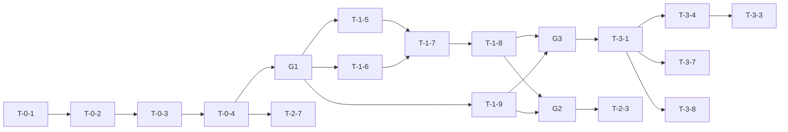

# Tasks: Feature Intelligence

**Last reviewed:** 2026-10-25 (post-ship contract sync)  
**Status:** Current (execution checklist; not a spec)

**Role:** Agent/human **execution checklist** only — not product requirements.  
**Specs (what):** [feature-intelligence.md](../specs/feature-intelligence.md) and linked specs.  
**Initiative (why, scope, gates):** [feature-intelligence.md](../initiatives/feature-intelligence.md).

Pattern: separate **tasks** from **specs** (cf. [Addy Osmani — specs and tasks for AI coding](https://addyo.substack.com/p/specs-and-tasks-the-secret-to-getting)) so builders iterate checkboxes here without editing contracts.

**Rules:** Respect **Depends on** and wave **gates**; do not start a task until dependencies are done. Use ids in commits (`feat(fi): T-1-5`).

**Seed CLI:** `pnpm seed:fi` (root) = `pnpm --filter @repo/fi seed`.

**Spike checkboxes:** Wave 1–2 items marked `[x]` are local spikes—re-verify against **G1** / **T-0-4** before treating as done for Build.

---

## Gates

| Gate | Unblocks |
| --- | --- |
| **G1** | Wave 1 DB integration — requires **T-0-4** |
| **G2** | Wave 2 eve — requires **T-1-8** and **T-1-9** |
| **G3** | Wave 3 web — requires **T-0-4**, **T-1-8**, **T-1-9** (eve may lag) |
| **G4** | Ship — **T-3-9**, **T-4-4**, **T-4-3**; `/chat` (**T-4-2**) and **T-4-1** are post-ship / cut-first per initiative |

**Critical path (serial planning view):** T-0-1 → T-0-2 → T-0-3 → T-0-4 → T-1-5 & T-1-6 → T-1-7 → T-1-8 → T-1-9 → T-3-1 → T-3-4 → T-3-3 → T-3-7 → T-3-8 → T-4-5

**Parallel after G1:** **T-1-9** (queue/disposition APIs) only needs **T-0-4** and can run beside **T-1-5 → T-1-6 → T-1-7 → T-1-8**. **T-2-7** (`eve init`) also only needs **T-0-4** and can run beside Wave 1 harness work; it is not a **G2**/**G3** gate.

---

## Wave 0 — Database

- [x] **T-0-1** — Neon Path A or B; repo-root `.env` → [initiative § Neon](../initiatives/feature-intelligence.md#plan--postgres--neon-connectivity)
- [x] **T-0-2** — `pnpm db:migrate` (after T-0-1)
- [x] **T-0-3** — `pnpm db:ping` (after T-0-2)
- [x] **T-0-4** — `pnpm seed:fi` (after T-0-3)
- [x] **T-0-5** — `pnpm --filter @repo/db db:check` (after T-0-2; ∥ T-0-3/4)

---

## Wave 1 — `@repo/fi`

Spike (re-verify after G1):

- [x] **T-1-1** — schema + `0002_feature_intelligence`
- [x] **T-1-2** — metrics + `getInsights` tests
- [x] **T-1-3** — T0 retrieve + T1 theme
- [x] **T-1-4** — `packages/fi/src/ai/gateway.ts`
- [x] **T-1-11** — seed fixture/load (verify on T-0-4)

Build:

- [ ] **T-1-5** — `classify-decisions.ts` (T2 Jev via gateway) — depends **G1**, T-1-4
- [ ] **T-1-6** — `synthesize-artifact.ts` (T3) — depends **G1**, T-1-4; **∥ T-1-5**
- [ ] **T-1-7** — full `runTriageHarness` — depends T-1-3, T-1-5, T-1-6
- [x] **T-1-8** — `createDraftAndTriage`, `confirmRequest`, `getRequest` — depends T-1-7, T-0-4
- [x] **T-1-9** — queue, disposition, support, `recordPmReviewStarted` — depends T-0-4; **∥ T-1-5…T-1-8** after G1
- [ ] **T-1-10** — offline `triage-matrix` — depends T-1-7

---

## Wave 2 — eve (after G2)

Spike:

- [x] **T-2-2** — `agent/instructions.md`

- [x] **T-2-7** — `eve init`, `agent.ts` — ∥ Wave 1 after T-0-4
- [x] **T-2-1** — read tools: `search_requests`, `list_triage_queue`, `get_insights` (+ `get_request` when added); spike partial—**verify** after T-2-7
- [x] **T-2-3** — core mutation/read tools: `get_request`, `submit_request`, `set_disposition` (+ read tools if not done in T-2-1) — depends T-1-8, T-1-9, T-2-7; aligns [eve MVP tools](../specs/feature-intelligence-eve-agent.md#mvp-tool-surface)
- [x] **T-2-4** — `confirm_request`, `support_request` — depends T-2-3 (optional)
- [x] **T-2-5** — `evals/evals.config.ts` — depends T-0-4, T-2-7
- [x] **T-2-6** — smoke evals incl. AG-7 — depends T-2-3, T-2-5, T-2-7

---

## Wave 3 — Web (after **G3**: T-0-4, T-1-8, T-1-9 — eve may lag)

- [x] **T-3-1** — `FiShell` + triage badge — depends T-1-9
- [x] **T-3-2** — `/` persona router — depends T-3-1; **∥ T-3-5**
- [x] **T-3-4** — server actions triage/confirm — depends T-1-8, T-3-1
- [x] **T-3-3** — `/requests/new` + contexts — depends T-3-4, T-3-1
- [x] **T-3-5** — `/requests` discover — depends T-3-1, T-0-4
- [x] **T-3-6** — `/requests/[id]` — depends T-3-5, T-3-4
- [x] **T-3-7** — `/triage` inline — depends T-3-1, T-1-9
- [x] **T-3-8** — `/insights` — depends T-3-1, T-1-2, T-0-4
- [x] **T-3-9** — agent-browser P0 (W-1–W-7) — depends T-3-3, T-3-5, T-3-7, T-3-8

---

## Wave 4 — Ship

- [x] **T-4-1** — `eve/next` — depends T-2-3
- [x] **T-4-2** — `/chat` + Anthropic — optional post-**G4** (cut first if behind); **∥** Wave 3 when time allows
- [x] **T-4-3** — README assessment — depends T-3-7, T-3-8 (core routes + metrics visible)
- [x] **T-4-4** — `pnpm qa`
- [x] **T-4-5** — Demo rehearsal walkthrough (web-only script; external recorder—no app integration) — depends T-3-9, T-4-4

---

## Dependency diagram

---

## Verification index

| Tasks | Doc |
| --- | --- |
| T-0-* | [seed](../specs/feature-intelligence-seed.md), initiative Neon plan |
| T-1-* | [harness](../specs/feature-intelligence-triage-harness.md), [testing](../specs/feature-intelligence-testing.md) |
| T-2-* | [eve agent](../specs/feature-intelligence-eve-agent.md) AG-* |
| T-3-* | [journeys](../specs/feature-intelligence-journeys.md), W-* in testing spec |
| T-4-* | [feature-intelligence.md](../specs/feature-intelligence.md) Submission README |
