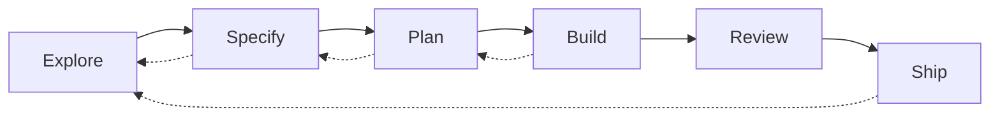

# Working with Flow

You do not need a command vocabulary. Describe what you want in ordinary language. The agent infers the activity from your intent, existing repository context, uncertainty, and any explicit authorization you give—not from memorized slash commands.

## Proportional process

Use the least workflow that fits the risk.

- A **small, well-understood fix** can go straight to **Build → Review → Ship** when you ask clearly (for example, “please fix it”).
- **Substantial new product work** normally starts in **Explore**, even if you arrive with a long brief or say “build this feature.”
- **Plan approval** and **Build authorization** are separate for substantial work: agreeing to a plan does not authorize implementation until you say so explicitly.

Exact checkpoints: [flow.md](flow.md).

## Three everyday scenarios

### 1. Known bug (bounded fix)

**You:** “The invoice list sorts dates as text. Please fix it.”

**Collaboration:** Build, then Review, then Ship. No discovery interview unless you want a durable record.

**Artifacts:** Code and a test.

**Progress:** Correct sort behavior and an honest report of which commands ran. That is completion for this kind of task.

### 2. Uncertain feature (learning before scale)

**You:** “Let’s add team comments.”

**Collaboration:** This is substantial new work, so it starts in **Explore** even if you used the word “build.” The agent should separate the product assumption from the implementation, ask only questions that change decisions, and present a short decision summary before advancing to Specify. You approve consequential scope and requirements before substantial planning. After you approve a plan, **Build** still needs its own explicit authorization.

**Artifacts:** Maybe an initiative once the work is bounded; updates to `PRODUCT.md` only when product-wide direction changes.

**Progress:** Success is not only merged code. It can be a decision to test an assumption, narrow scope, or stop. Shipping comments without evidence they matter is not automatic success.

### 3. Fresh session (resume)

**You:** “Continue the comments initiative.”

**Collaboration:** The agent reads the initiative and accepted contracts (`PRODUCT.md`, relevant ADRs/PDRs), states the current stage, what is already approved, open questions, and the **next authorization** you must give. It should not re-ask settled decisions.

**Progress:** Clear continuity and the next explicit action—not replaying earlier exploration.

## Activities you revisit

Explore, Specify, Plan, Build, Review, and Ship are **activities**, not gates every change must pass in order. Move backward when uncertainty returns or evidence challenges an accepted decision.

Dotted edges mean: new evidence or risk can send you back to an earlier activity. This is not a mandatory pipeline for every bug fix.

## What “done” means

| Kind of work | Done when |
| --- | --- |
| Bug fix | Behavior matches intent; relevant checks reported honestly |
| Learning decision | Assumption tested or explicitly deferred; findings recorded if durable |
| Implementation slice | Verified and integrated into local `main`; limitations stated at Ship |

Technical verification and customer-value evidence are different questions ([learning-and-improvement.md](learning-and-improvement.md)).

## Where to go next

- Trade-offs behind the practices: [principles.md](principles.md)
- Document homes: [project-context.md](project-context.md)
- Worktrees and parallel agents: [agents/worktrees.md](../agents/worktrees.md), [agents/delegation.md](../agents/delegation.md)
